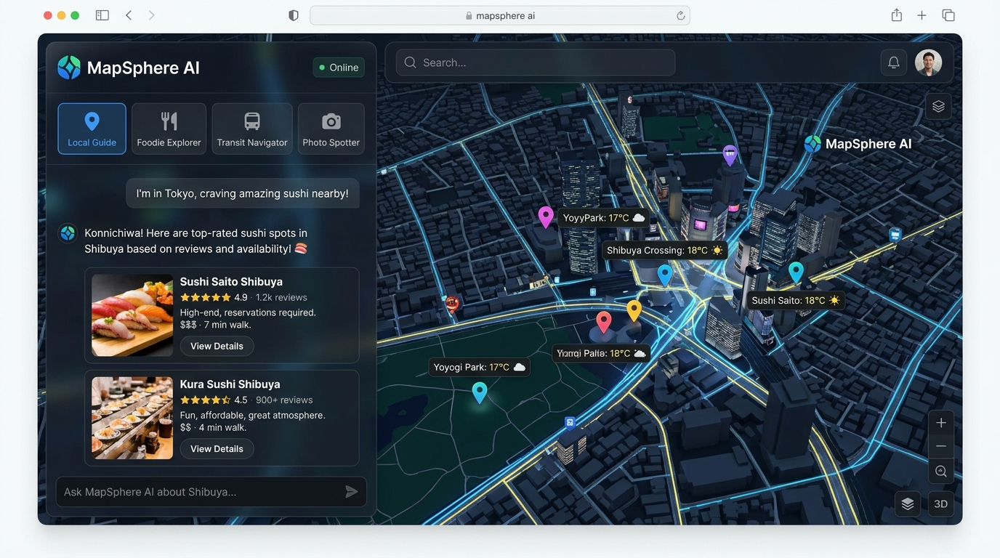
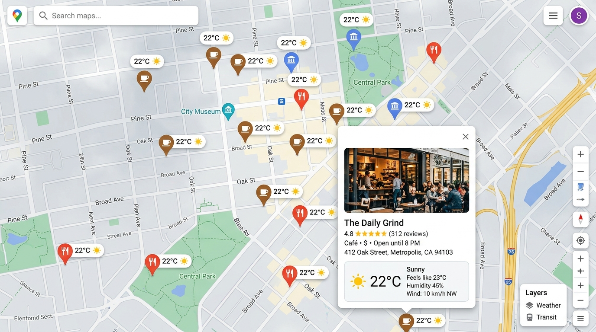
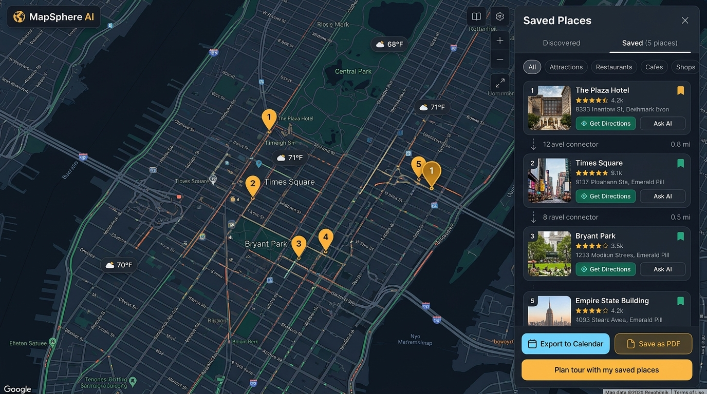
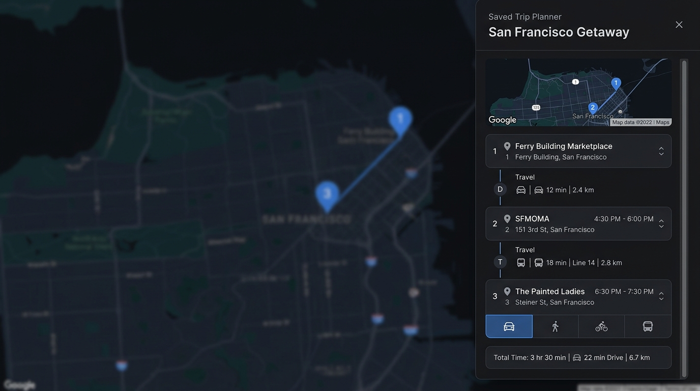
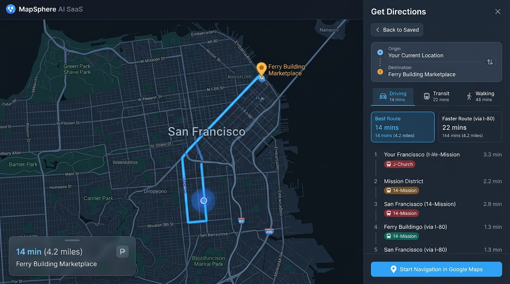
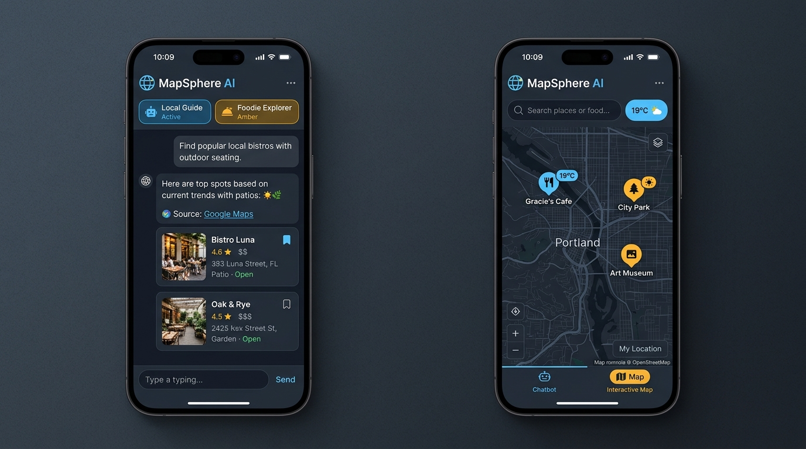

# MapSphere AI — Intelligent Geospatial Chatbot & Travel Companion

[](https://react.dev/)
[](https://www.typescriptlang.org/)
[](https://developers.google.com/maps)
[](https://ai.google.dev/)
[](https://open-meteo.com/)
[](https://tailwindcss.com/)

**MapSphere AI** is a real-time, map-driven conversational exploration platform that pairs **Google Maps Platform** with **Google Gemini** and open meteorological data. Explore any city on Earth, ask location-aware questions, inspect real-time weather overlays on map markers, bookmark favorite places across sessions, calculate multi-stop Distance Matrix itineraries, view live multi-modal turn-by-turn directions, and export complete trip plans to Calendar (`.ics`) or PDF.

---

## 📸 App Screenshots & All Screens

| Screen | Overview |
| --- | --- |
| [1. Main Split-Screen Interface](#1-main-split-screen-interface--ai-chat--interactive-map) | Grounded multi-persona AI chat paired with an interactive Google Map & category pins |
| [2. Real-Time Weather & Place InfoWindow](#2-real-time-open-meteo-weather-overlays--place-infowindow) | Floating Open-Meteo temperature badges on pins with rich venue details & °C/°F switcher |
| [3. Saved Places & Itinerary Export](#3-saved-places-drawer--itinerary-export-calendar-ics--pdf) | Bookmarked stops with category filters, Get Directions buttons, and `.ics` / `.pdf` exports |
| [4. Multi-Stop Trip Planner & Distance Matrix](#4-multi-stop-trip-planner--distance-matrix-travel-times) | Ordered route stops with live leg-by-leg travel durations across Drive, Walk, Bike & Transit |
| [5. Get Directions & Live Route Polyline](#5-multi-modal-get-directions--live-route-polyline) | Walking, Transit, and Driving route options from current GPS location with step-by-step instructions |
| [6. Responsive Mobile Experience](#6-responsive-mobile-experience-chatbot--interactive-map-tabs) | Mobile bottom-tab layout switching seamlessly between the AI Chatbot and Interactive Map |

---

### 1. Main Split-Screen Interface — AI Chat & Interactive Map
MapSphere AI pairs a responsive, glassmorphic conversational companion on the left with a full-bleed interactive Google Map on the right. Switch between AI travel personas (**Local Guide**, **Foodie Explorer**, **Transit Navigator**, **Cultural Curator**), toggle Maps/Search grounding, jump between preset world cities, and watch discovered places pin onto the map in real time.

<p align="center">
  
</p>

---

### 2. Real-Time Open-Meteo Weather Overlays & Place InfoWindow
Live local weather data from **Open-Meteo** is overlaid directly above every location pin with temperature pills and WMO weather icons. Clicking any marker opens an enriched **InfoWindow** displaying category tags, ratings, street address, local weather conditions with a 1-click **°C / °F** toggle, bookmark controls, and an **Ask AI about this** shortcut.

<p align="center">
  
</p>

---

### 3. Saved Places Drawer & Itinerary Export (Calendar `.ics` & PDF)
Bookmark your favorite locations across sessions with `localStorage` persistence. The **PlacesDrawer** provides separate **Discovered** and **Saved** tabs, category filter chips, quick **Get Directions** and **Ask AI** actions per stop, and downloadable itinerary exports:
- **Export to Calendar (`.ics`)**: Standard RFC 5545 calendar file scheduling sequential stops with addresses, GPS `GEO` coordinates, descriptions, and transit spacing.
- **Save as PDF (`.pdf`)**: Formatted multi-page itinerary document generated client-side via `jspdf` with trip totals, numbered stop cards, leg travel times, and clickable Google Maps links.

<p align="center">
  
</p>

---

### 4. Multi-Stop Trip Planner & Distance Matrix Travel Times
When two or more places are saved, MapSphere AI calculates sequential leg-by-leg travel durations and distances using the **Google Maps Routes API (`v2:computeRouteMatrix`)**. Reorder stops with Up/Down arrows, switch between **Drive**, **Walk**, **Bike**, and **Transit**, inspect total trip time, or launch the complete multi-stop route in Google Maps.

<p align="center">
  
</p>

---

### 5. Multi-Modal "Get Directions" & Live Route Polyline
Clicking **Get Directions** on any saved place opens the **DirectionsPanel**, powered by the **Google Maps Routes API (`v2:computeRoutes`)**:
- Routes from **Your Current Location** (browser GPS) with an instant fallback toggle to **Current Map Center**.
- Compares **Driving** (traffic-aware), **Transit**, and **Walking** ETAs side-by-side in tabs.
- Displays primary and alternative route options, decodes and draws mode-styled polylines directly onto the map (blue for driving, purple for transit, dotted emerald for walking), auto-fits the viewport, and lists turn-by-turn steps with public transit line badges, stops, and schedules.

<p align="center">
  
</p>

---

### 6. Responsive Mobile Experience (Chatbot & Interactive Map Tabs)
On mobile screens, MapSphere AI adapts into a clean tabbed layout with a persistent bottom navigation bar to switch effortlessly between the **Chatbot** conversation feed and the **Interactive Map** with live weather badges and geolocation controls.

<p align="center">
  
</p>

---

## ✨ Key Features

- **🗺️ Interactive Google Maps Integration**:
  - Built with `@vis.gl/react-google-maps` and Google Maps JavaScript API (`AdvancedMarker` + `Pin`).
  - Category-themed color markers (Restaurants, Cafes, Landmarks, Parks, Museums, Shopping, Hotels).
  - Roadmap, Satellite, and Hybrid cartography switcher + live `TrafficLayer` toggle.
  - Jump-to-city shortcuts and pulsing live GPS user location marker.
- **🤖 Grounded AI Location Chat**:
  - Viewport-aware prompting using current map center coordinates and zoom level.
  - Four selectable travel personas (**Local Guide**, **Foodie Explorer**, **Transit Navigator**, **Cultural Curator**).
  - Google Maps & Google Search grounding with verified source citation chips.
- **⛅ Open-Source Real-Time Weather Overlay**:
  - Powered by **Open-Meteo** (keyless global weather API) with 15-minute coordinate-rounded in-memory caching.
  - Marker weather badges, InfoWindow local weather widget, viewport center weather pill, visibility toggle, and °C/°F unit switcher.
- **⭐ Saved Places, Distance Matrix & Itinerary Export**:
  - Persistent bookmarking via `localStorage` with stop reordering and category filters.
  - Multi-modal travel times between saved stops via Google Maps Routes API (`computeRouteMatrix`).
  - One-click **Export to Calendar (`.ics`)** and **Save as PDF (`.pdf`)** downloads.
- **🧭 Turn-by-Turn Multi-Modal Directions**:
  - Walking, Transit, and Driving route options from the user's current location via Google Maps Routes API (`computeRoutes`).
  - Alternative route selection, step-by-step maneuvers, rich transit details, live map polyline overlay, and Google Maps handoff.

---

## 🏗️ Architecture & Tech Stack

```text
├── index.html                           # HTML entry point & SEO metadata
├── metadata.json                        # Application capability descriptors
├── server.ts                            # Express server (API proxy + Vite middleware in dev)
├── server/
│   ├── apiRouter.ts                     # /api/chat, /api/routes/distance-matrix, /api/routes/directions
│   └── geminiService.ts                 # @google/genai grounded location chat handler
├── src/
│   ├── assets/images/                   # Application screenshots for README documentation
│   ├── components/
│   │   ├── ChatPanel.tsx                # AI conversation panel, personas & grounding controls
│   │   ├── MapContainer.tsx             # Google Map, AdvancedMarkers, Weather pills & Route polyline
│   │   ├── PlacesDrawer.tsx             # Discovered/Saved tabs, Distance Matrix & Export actions
│   │   ├── DirectionsPanel.tsx          # Walking/Transit/Driving route options & turn-by-turn steps
│   │   └── QuotaBanner.tsx              # Non-intrusive Google Maps quota notice banner
│   ├── constants/
│   │   └── personas.ts                  # Persona definitions & preset global destinations
│   ├── services/
│   │   ├── weatherService.ts            # Open-Meteo API client, WMO interpreter & TTL cache
│   │   └── itineraryExportService.ts    # RFC 5545 .ics calendar & jsPDF itinerary generators
│   ├── types.ts                         # Shared TypeScript interfaces
│   ├── App.tsx                          # Root state orchestration & responsive layout
│   └── main.tsx                         # React DOM mount & Maps error hooks
```

### Technology Highlights
- **Frontend**: React 19, TypeScript, Tailwind CSS v4, Lucide React, Motion, `jsPDF`.
- **Mapping & Routing**: `@vis.gl/react-google-maps`, Google Maps JavaScript API, Google Maps Routes API (`v2:computeRoutes` & `v2:computeRouteMatrix`).
- **Backend**: Express on Node.js (`tsx server.ts`) with Vite middleware in development.
- **AI & Weather**: `@google/genai` SDK + Open-Meteo Forecast API.

---

## 🚀 Getting Started

### 1. Prerequisites
- Node.js 20+
- Google Maps Platform API Key with **Maps JavaScript API**, **Geocoding API**, and **Routes API** enabled.
- Google Gemini API Key.

### 2. Environment Variables
Create a `.env` file in the project root (see `.env.example`):

```env
GEMINI_API_KEY="your-gemini-api-key"
VITE_GOOGLE_MAPS_API_KEY="your-google-maps-api-key"
APP_URL="http://localhost:3000"
```

### 3. Installation & Commands

```bash
# Install dependencies
npm install

# Start full-stack dev server on port 3000
npm run dev

# Type-check & lint
npm run lint

# Build production bundle
npm run build

# Run production server
npm start
```

---

## 📡 API Reference

| Endpoint | Method | Description |
| --- | --- | --- |
| `/api/health` | `GET` | Server health check and Gemini configuration status |
| `/api/chat` | `POST` | Grounded location chat returning AI reply, structured `PlaceMarker[]`, and citations |
| `/api/routes/distance-matrix` | `POST` | Multi-stop leg durations & distances via Routes API `v2:computeRouteMatrix` |
| `/api/routes/directions` | `POST` | Driving, Transit, and Walking route options, polylines, and steps via Routes API `v2:computeRoutes` |

---

## 📄 License
This project is licensed under the Apache 2.0 License.
