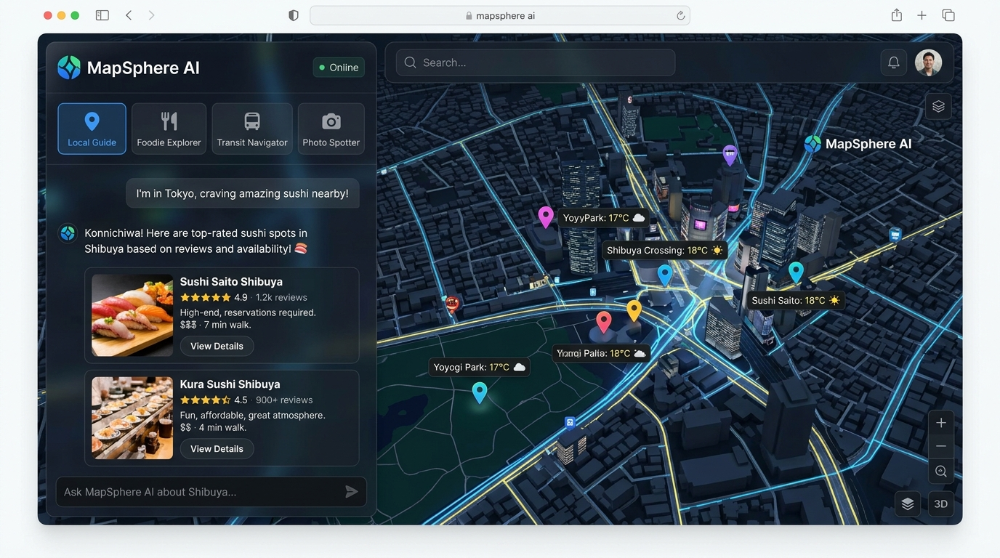
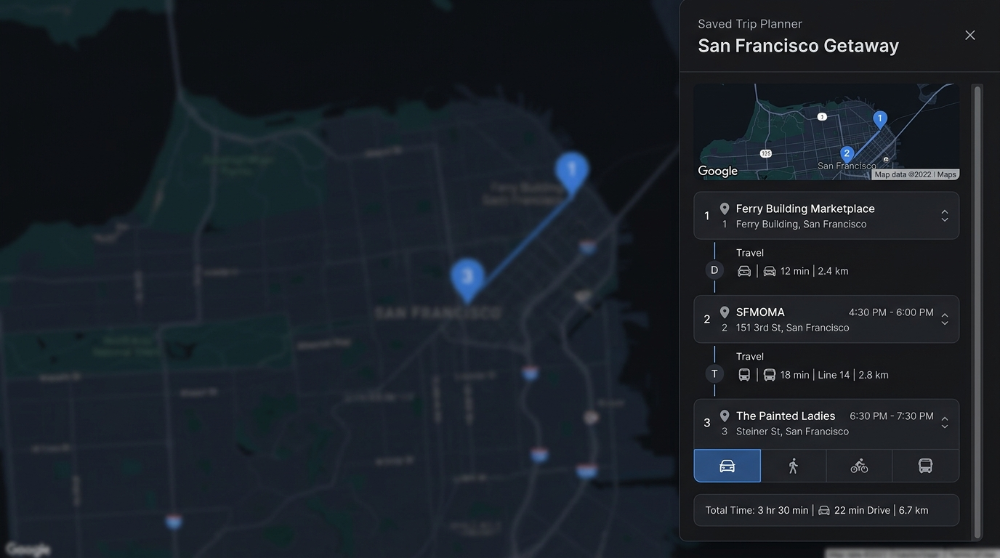
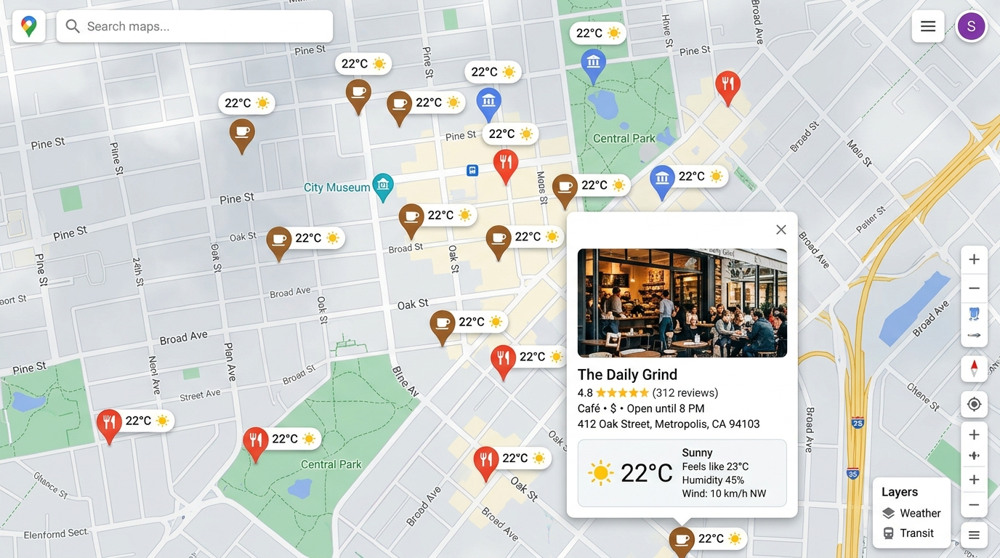

# MapSphere AI — Intelligent Geospatial Chatbot & Travel Companion

[](https://react.dev/)
[](https://www.typescriptlang.org/)
[](https://developers.google.com/maps)
[](https://ai.google.dev/)
[](https://open-meteo.com/)
[](https://tailwindcss.com/)

**MapSphere AI** is a real-time, map-driven conversational exploration platform that pairs **Google Maps Platform** with **Google Gemini 2.5** and open meteorological data. Users can explore any city on Earth, ask contextual questions, discover curated points of interest with real-time weather overlays, save favorite spots across sessions, and compute multi-modal transit itineraries using the Google Maps Distance Matrix.

---

## 📸 App Screenshots

### 1. Interactive Geospatial Chat & Dynamic Map Interface
MapSphere AI combines a responsive, glassmorphic conversational companion with an interactive Google Map featuring custom category pins, live traffic overlays, and real-time weather pill badges.

<p align="center">
  
</p>

---

### 2. Multi-Stop Saved Trip Planner & Distance Matrix
Organize favorite destinations into a custom travel itinerary. MapSphere AI automatically calculates multi-modal travel times and distances between each stop using the Google Maps Routes API (Distance Matrix), with support for Driving, Walking, Bicycling, and Transit.

<p align="center">
  
</p>

---

### 3. Real-Time Open-Meteo Weather Overlays & Place Details
Real-time weather conditions from Open-Meteo are overlaid directly on each location marker. Clicking any pin displays a rich InfoWindow with venue details, rating, photo, and live atmospheric conditions with a 1-click Celsius/Fahrenheit toggle.

<p align="center">
  
</p>

---

## ✨ Key Features

- **🗺️ Interactive Google Maps Integration**:
  - Built with `@vis.gl/react-google-maps` and Google Maps JavaScript API (v=weekly).
  - Advanced Markers (`AdvancedMarker` + `Pin`) with category-themed color glyphs (Restaurants, Cafes, Landmarks, Parks, Museums, Shopping, Hotels).
  - Map styling options: Roadmap, Satellite, and Hybrid cartography.
  - Live Google Traffic layer toggle (`google.maps.TrafficLayer`).
  - Jump-to-city quick shortcuts (Tokyo, Paris, New York, San Francisco, Rome, Sydney, Cairo, Rio de Janeiro).
  - User geolocation lookup with animated pulsing location marker.

- **🤖 Grounded AI Chat with Gemini 2.5**:
  - Contextual awareness: AI prompt incorporates current map center coordinates and zoom level.
  - Multi-persona travel companions:
    - 🧭 **Local Guide**: Hidden gems, historic neighborhoods, and authentic local customs.
    - 🍜 **Foodie Explorer**: Culinary specialties, street food stalls, and Michelin-starred dining.
    - 🚇 **Transit Navigator**: Route efficiency, transit lines, and commute recommendations.
    - 🏛️ **Cultural Curator**: Architecture, museums, galleries, and historic landmarks.
  - Model selector supporting `gemini-2.5-flash` and `gemini-2.5-pro`.
  - Maps Grounding & Google Search Grounding toggle with verified source citation pills.

- **⛅ Open-Source Real-Time Weather Overlay**:
  - Powered by **Open-Meteo API** (keyless, high-precision global weather).
  - Displays floating weather pills directly above place pins showing temperature and WMO weather condition icons (☀️ Clear, ⛅ Partly Cloudy, 🌧️ Rain, 🌨️ Snow, ⛈️ Thunderstorm).
  - Regional weather monitor in top toolbar reflecting current viewport center conditions.
  - Instant °C / °F temperature unit toggle with local storage persistence.
  - 15-minute in-memory caching layer keyed by rounded geographic coordinates to reduce network bandwidth.

- **⭐ Saved Places & Persistent Bookmarking**:
  - 1-click bookmarking from map pins, InfoWindows, chat recommendation cards, and places drawer.
  - Persisted across browser sessions using `localStorage`.
  - Reorder itinerary stops with Up/Down buttons to plan custom sightseeing sequences.
  - Export itinerary as a multi-stop navigation route directly in Google Maps.

- **⏱️ Multi-Modal Distance Matrix Travel Times**:
  - Backend integration with Google Maps Routes API (`v2:computeRouteMatrix`).
  - Computes travel durations and distances between consecutive saved stops.
  - Supports 4 travel modes: **Drive** (🚗), **Walk** (🚶), **Bicycle** (🚲), and **Transit** (🚇).
  - Displays leg-by-leg connectors and overall journey duration summary.

---

## 🏗️ Architecture & Tech Stack

```text
├── index.html                   # HTML entry point with metadata & Google Fonts
├── metadata.json                # AI Studio capability descriptors
├── server.ts                    # Node/Express backend proxying Gemini & Routes API
├── src/
│   ├── assets/images/           # High-resolution screenshots and UI visual assets
│   ├── components/
│   │   ├── ChatDrawer.tsx       # AI conversation panel & persona selector
│   │   ├── MapContainer.tsx     # Google Map, AdvancedMarkers, Weather pills & InfoWindow
│   │   └── PlacesDrawer.tsx     # Discovered places, Saved places & Distance Matrix
│   ├── services/
│   │   ├── weatherService.ts    # Open-Meteo weather client, WMO parser & cache
│   │   └── routesService.ts     # Google Maps Routes API Distance Matrix client
│   ├── types.ts                 # TypeScript interfaces for places, weather & routes
│   ├── App.tsx                  # Root state orchestration & layout
│   └── main.tsx                 # React DOM mount point
```

### Technology Highlights
- **Frontend**: React 19, TypeScript, Tailwind CSS v4, Lucide React icons, Motion animations.
- **Mapping**: `@vis.gl/react-google-maps` with Google Maps JavaScript API and Solution Attribution tracking.
- **Backend**: Express on Node.js running via `tsx` with Vite middleware integration in development.
- **AI Engine**: `@google/genai` TypeScript SDK invoking `gemini-2.5-flash` with structured place extraction.
- **APIs**:
  - Google Maps JavaScript API (Map rendering, Geocoding, Places)
  - Google Maps Routes API (`https://routes.googleapis.com/distanceMatrix/v2:computeRouteMatrix`)
  - Open-Meteo Weather API (`https://api.open-meteo.com/v1/forecast`)

---

## 🚀 Getting Started

### 1. Prerequisites
- Node.js 20+
- Google Maps Platform API Key with **Maps JavaScript API**, **Geocoding API**, and **Routes API** enabled.
- Google Gemini API Key.

### 2. Environment Variables
Create a `.env` file in the project root:

```env
# Gemini API Key (injected automatically in Google AI Studio)
GEMINI_API_KEY="your-gemini-api-key"

# Google Maps API Key
VITE_GOOGLE_MAPS_API_KEY="your-google-maps-api-key"

# Application URL
APP_URL="http://localhost:3000"
```

### 3. Installation & Development

```bash
# Install dependencies
npm install

# Start development server (serves on port 3000)
npm run dev

# Lint and type check
npm run lint

# Build production bundle
npm run build

# Start production server
npm start
```

---

## 📡 API Reference

### `POST /api/chat`
Proxies chat requests to Gemini with location context and extracts structured places.
- **Request Body**:
  ```json
  {
    "messages": [{ "role": "user", "text": "Best ramen in Shibuya?" }],
    "locationContext": { "lat": 35.658, "lng": 139.701, "zoom": 14 },
    "rolePersona": "foodie",
    "model": "gemini-2.5-flash"
  }
  ```
- **Response**: `{ reply: string, places: PlaceMarker[], groundingSources: GroundingSource[] }`

### `POST /api/routes/distance-matrix`
Computes travel times and distances between an ordered list of destinations.
- **Request Body**:
  ```json
  {
    "places": [
      { "id": "1", "name": "Stop A", "lat": 37.7749, "lng": -122.4194 },
      { "id": "2", "name": "Stop B", "lat": 37.7833, "lng": -122.4167 }
    ],
    "travelMode": "DRIVE"
  }
  ```
- **Response**: `{ travelMode: "DRIVE", segments: RouteSegment[], totalDurationSeconds: 720, ... }`

---

## 📄 License
This project is licensed under the Apache 2.0 License.
